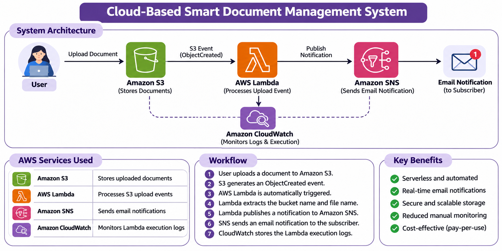

# Cloud-Based Smart Document Management System

A serverless AWS application that stores documents in Amazon S3 and sends email notifications through Amazon SNS using AWS Lambda.

## 1. Project Overview

The Cloud-Based Smart Document Management System automates document upload notifications using AWS cloud services. When a new document is uploaded to the configured S3 bucket, an S3 event is configured to invoke an AWS Lambda function. The function processes the event and publishes a notification to Amazon SNS, which delivers an email to subscribed users.

## 2. Problem Statement

Manually monitoring document uploads can be time-consuming. This project demonstrates how AWS serverless services can be integrated to simplify document storage and upload notifications.

## 3. Objectives

- Store documents in Amazon S3.
- Configure automatic detection of new document uploads.
- Process upload events using AWS Lambda.
- Send email notifications using Amazon SNS.
- Monitor Lambda execution using Amazon CloudWatch.

## 4. AWS Services Used

| AWS Service | Purpose |
|---|---|
| Amazon S3 | Stores uploaded documents |
| AWS Lambda | Processes S3 upload events |
| Amazon SNS | Sends email notifications |
| Amazon CloudWatch | Stores execution logs |

**Core services:** Amazon S3, AWS Lambda and Amazon SNS. CloudWatch is used for supporting monitoring.

## 5. System Architecture

### Workflow

1. A user uploads a document to the Amazon S3 bucket.
2. Amazon S3 generates an ObjectCreated event.
3. The configured event trigger invokes AWS Lambda.
4. Lambda extracts the bucket name and uploaded file name.
5. Lambda publishes a notification to the SNS topic.
6. Amazon SNS sends an email to the confirmed subscriber.
7. Amazon CloudWatch stores Lambda execution logs.

## 6. Implementation Details

- **S3 Bucket:** `smartdocvault2026pooja`
- **SNS Topic:** `DocumentUploadNotifications`
- **Lambda Function:** `document-upload-processor`
- **Runtime:** Python
- **Event Type:** `s3:ObjectCreated:*`
- **Notification Method:** Email through Amazon SNS

The Lambda function uses Python and Boto3 to publish document upload information to the configured SNS topic.

## 7. Source Code

- [Lambda Function Code](lambda_function.py)
- [System Architecture](architecture.png)

## 8. Testing and Results

The Lambda function was tested using a sample S3 event payload. The test execution returned a successful response, and an email notification was received through Amazon SNS.

The S3 ObjectCreated trigger configuration is also included in the project evidence.

## 9. Project Screenshots

The following screenshots document the AWS implementation:

| Screenshot | Description |
|---|---|
| [01 - S3 Bucket Objects](screenshots/01_S3_Bucket_Objects.png) | Uploaded documents in S3 |
| [02 - SNS Topic](screenshots/02_SNS_Topic_and_Confirmed_Subscription.png) | SNS topic and confirmed subscription |
| [03 - SNS Subscription](screenshots/03_SNS_Subscription_Details.png) | Email subscription details |
| [04 - Lambda Overview](screenshots/04_Lambda_Function_Overview_and_Test_Tab.png) | Lambda function overview |
| [05 - Lambda Code](screenshots/05_Lambda_Function_Code.png) | Python function code |
| [06 - S3 Trigger](screenshots/06_Lambda_S3_Trigger_Configuration.png) | S3 trigger configuration |
| [07 - Lambda Test](screenshots/07_Lambda_Test_Success_Result.png) | Successful test execution |
| [08 - Email Notification](screenshots/08_Email_Notification_Received.png) | SNS email notification |
| [09 - CloudWatch](screenshots/09_CloudWatch_Log_Group_Details.png) | CloudWatch log group |
| [10 - Lambda Overview](screenshots/10_Lambda_Function_Overview.png) | Lambda configuration evidence |

## 10. Technologies Used

- AWS Cloud
- Python
- Boto3
- Amazon S3
- AWS Lambda
- Amazon SNS
- Amazon CloudWatch
- GitHub

## 11. Conclusion

This project demonstrates how serverless AWS services can be integrated to build a cloud-based document notification workflow. It combines object storage, event-driven processing and email notifications, reducing the need for manual upload monitoring.

## 12. GitHub Repository

[Smart Document Management System](https://github.com/poojasri515/smart-document-management-system)

